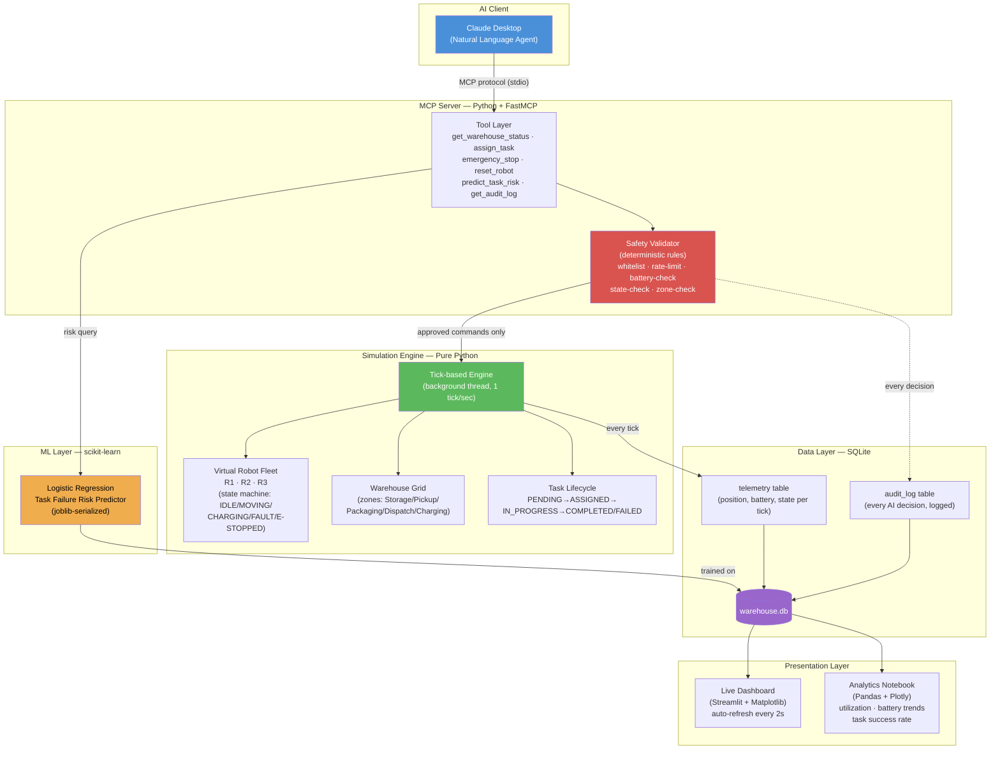

# 🏭 AI Warehouse Control System

A fully software-based, laptop-only warehouse simulation controlled through natural language — via an **MCP (Model Context Protocol) server** that connects an AI agent (Claude Desktop) to a simulated fleet of warehouse robots, with a **deterministic safety layer**, **live telemetry**, a **real-time dashboard**, and an **ML-based risk predictor**.

No physical hardware required. Everything runs on a single machine.

---

## 🎯 What This Project Demonstrates

This isn't a toy MCP demo — it's a small, end-to-end **AI + software systems** project built to show practical engineering across several disciplines:

- **AI Engineering** — MCP protocol implementation, tool schema design, safe LLM tool-calling, agent-system integration
- **Software Engineering** — layered architecture, state machines, dependency injection for testability, 47 automated tests
- **Data Science** — telemetry generation, EDA, utilization/battery/failure analysis (Pandas + Plotly)
- **Machine Learning** — a task-failure risk classifier (scikit-learn), trained on simulated telemetry, with honest evaluation and a documented [Model Card](analytics/MODEL_CARD.md)

**Core safety principle:** the AI agent never directly mutates system state. Every state-changing command passes through a deterministic Safety Validator before it reaches the simulation — the LLM proposes, the validator decides.

---

## 🧩 Architecture



---

## ✨ Features

| Capability | Description |
|---|---|
| 🗣️ **Natural language control** | Ask Claude Desktop to check status, assign tasks, or stop robots — no commands to memorize |
| 🛡️ **Safety Validator** | Every command is checked against deterministic rules (battery, state, zone validity, rate limits) before execution — independent of the LLM's judgment |
| 🤖 **Simulated robot fleet** | 3 virtual robots with a full state machine (IDLE → MOVING → DELIVERING → CHARGING / FAULT / EMERGENCY_STOPPED) |
| 📊 **Live dashboard** | Real-time warehouse map, robot status, and AI action log — auto-refreshing in the browser |
| 🗃️ **Full audit trail** | Every AI tool call, its approval/rejection, and the reason is logged to SQLite — nothing is a black box |
| 📈 **Analytics notebook** | Robot utilization, battery consumption trends, task success rate, and completion-time distribution |
| 🧠 **ML risk prediction** | A trained classifier estimates task failure risk *before* assignment, exposed as its own MCP tool |
| 🔒 **Single-instance lock** | OS-level file lock prevents two server instances from corrupting shared state |

---

## 🛠️ Tech Stack

| Layer | Technology | Why |
|---|---|---|
| Core language | Python 3.14 | Mature MCP SDK support, fits the data/ML tooling used elsewhere in the project |
| MCP server | [FastMCP](https://gofastmcp.com) | Lowest-boilerplate way to build an MCP server; community standard |
| Validation | Pydantic-style dataclasses | Strict tool/data schemas |
| Database | SQLite | Zero-setup, structured telemetry, SQL-ready for analytics |
| Dashboard | Streamlit + Matplotlib | Lightweight, Python-native live UI |
| Analytics | Pandas + Plotly | Standard EDA toolkit |
| ML | scikit-learn + joblib | Simple, interpretable models; easy serialization |
| Testing | pytest + pytest-asyncio | Unit + integration coverage, including in-memory MCP protocol tests |

---

## 📁 Project Structure

```
ai_warehouse_mcp/
├── simulation/        # Robot, Warehouse, Task models + tick-based Engine
├── safety/             # Deterministic Safety Validator (testable standalone)
├── mcp_server/         # FastMCP app: tool layer wiring Validator + Engine + DB
├── storage/            # SQLite persistence (telemetry, audit log) + singleton lock
├── dashboard/          # Streamlit live warehouse view
├── analytics/          # Data generation script, EDA notebook, ML model notebook
├── tests/              # 47 automated tests across every layer
├── config/settings.py  # Shared constants (battery thresholds, grid size, etc.)
└── run_server.bat      # Entry point for Claude Desktop (Windows)
```

---

## 🚀 Getting Started

### Prerequisites
- Python 3.10+
- Claude Desktop (for natural-language control)

### Installation

```powershell
git clone <your-repo-url>
cd ai_warehouse_mcp

python -m venv venv
venv\Scripts\activate

pip install -r requirements.txt
```

### Run the Tests

```powershell
pytest -v
```

Expected: **47 passed**.

### Connect to Claude Desktop

Add this to your `claude_desktop_config.json` (`%APPDATA%\Claude\claude_desktop_config.json`):

```json
{
  "mcpServers": {
    "ai-warehouse-mcp": {
      "command": "C:\\path\\to\\ai_warehouse_mcp\\run_server.bat"
    }
  }
}
```

Restart Claude Desktop fully, then try:
- *"What's the current status of my warehouse?"*
- *"Move robot R1 from Pickup to Dispatch"*
- *"What's the risk of sending R2 from Storage to Dispatch?"*
- *"Emergency stop R3"*

### Run the Live Dashboard

In a separate terminal:

```powershell
streamlit run dashboard/app.py
```

### Generate Analytics Data & Train the ML Model

```powershell
python analytics/generate_sample_data.py
jupyter notebook analytics/ml_model.ipynb
```

---

## 🧪 Testing Philosophy

The Safety Validator and Simulation Engine are tested **completely independently** of each other and of the MCP layer — randomness (`rng`) and time (`clock`) are injected as dependencies, so every test is deterministic and reproducible, including rate-limiting and fault-injection scenarios. MCP tool behavior is verified using FastMCP's in-memory `Client`, exercising the full protocol (schema, tool discovery, call, response) without needing a subprocess or external client.

---

## 🧠 Machine Learning — Task Failure Risk Prediction

A Logistic Regression model predicts the probability that an assigned task will fail (robot enters `FAULT` state mid-route), based on route distance and starting battery. It outperformed a Random Forest on this dataset size, and its predictions are compared against the dataset's baseline failure rate for interpretability.

Full methodology, metrics, and an **honest discussion of the model's limitations** (failure is partly stochastic by design, so predictive power is necessarily modest) are documented in [`analytics/MODEL_CARD.md`](analytics/MODEL_CARD.md).

---

## 🔮 Future Work

- Robot navigation toward the Charging zone (currently charges in place — an intentional MVP simplification)
- A/B comparison of additional models (e.g. gradient boosting) as more telemetry accumulates
- Human-approval step for `reset_robot` in a production setting (currently AI-callable for demo purposes)
- A*-based pathfinding and multi-robot collision avoidance
- WebSocket-based live dashboard updates instead of polling

---

## 📄 License

MIT
