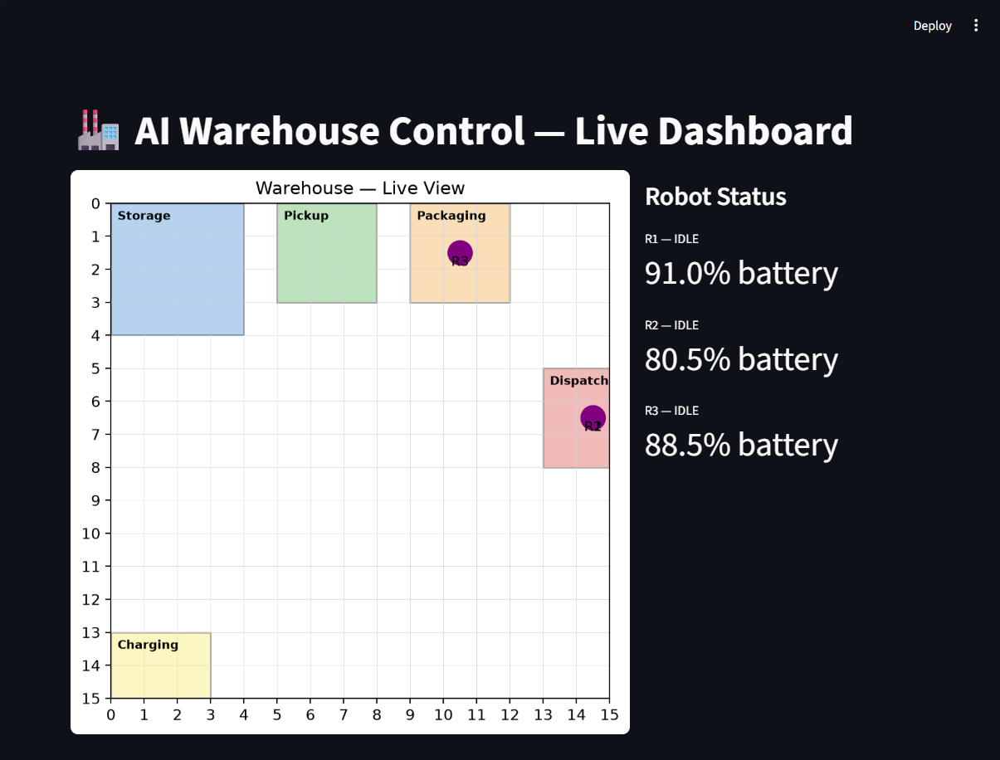
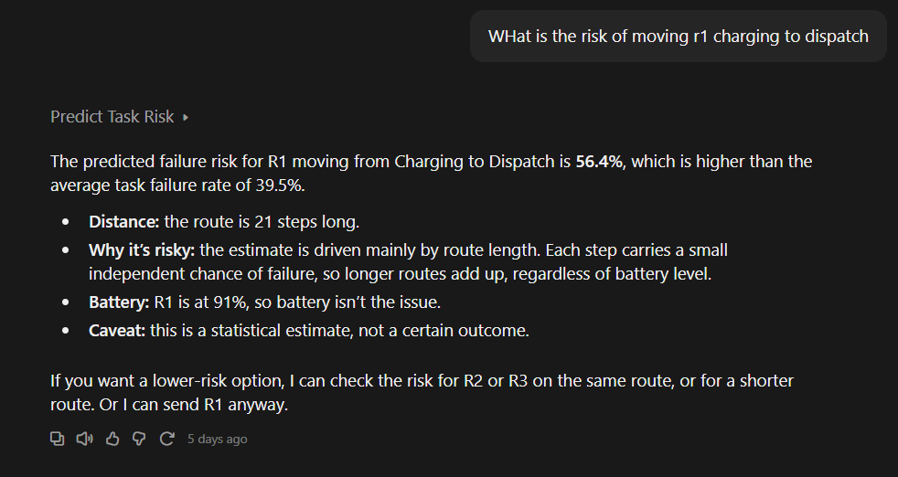
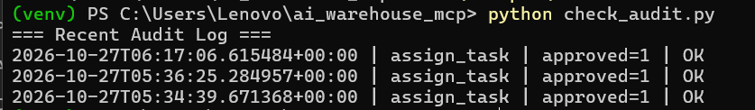
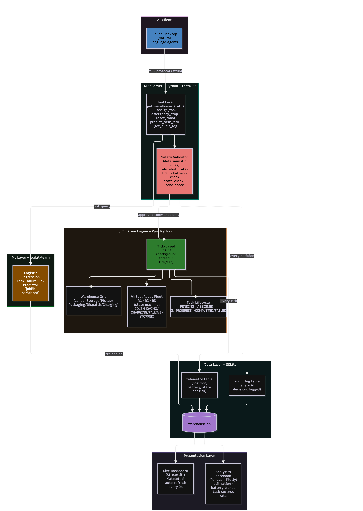

# 🏭 AI Warehouse Control System

**Talk to a simulated warehouse in plain English. The AI proposes, a deterministic safety layer decides.**

An MCP (Model Context Protocol) server connects an AI agent (Claude Desktop) to a fleet of simulated warehouse robots. Every command the AI sends passes through a rule-based **Safety Validator** before it can touch the simulation, and every decision is logged. It runs entirely on a laptop, with no hardware needed.


https://github.com/user-attachments/assets/99b602a8-a861-44b4-a980-85a8f6dcb1e2


> *"Move R1 from Storage to Dispatch"*: Claude calls the `assign_task` tool, the validator approves it, R1 starts moving on the live dashboard (left) and the action shows up in the audit log. Claude Desktop is on the right.

---

## 💡 Why this project exists

Giving an LLM control over anything real is risky: it can hallucinate a robot ID, ignore a low battery, or loop on a command. This project explores one answer to that problem:

> **The LLM never mutates system state directly.** It can only call a small set of MCP tools, and each state-changing call is independently validated by plain, testable code.

It started as inspiration from a physical ESP32 warehouse robot I built for a college project. I rebuilt the idea as a pure-software system so it can be developed, tested and demoed without any hardware.

---

## 🎥 More demos

Each clip is a split screen: live dashboard on the left, Claude Desktop on the right.

### 1. Risk prediction before acting

*"What is the risk of moving r1 charging to dispatch"*: the ML model predicts a 56.4% failure risk against a 39.5% average. Claude explains why: it is a 21-step route and every step carries a small independent chance of failure, so battery (91%) is not the problem.


https://github.com/user-attachments/assets/c1e76e28-3947-4c37-90f8-d2da41b70759


### 2. Loosely worded commands still work

*"move r3 storage to packaging"*: lowercase, no "from". Claude still resolves the right robot and zones and calls `assign_task`. The LLM handles the language; the validator and engine decide what actually happens.


https://github.com/user-attachments/assets/cdd28640-0e38-4d48-9b2e-d10e802fcc0c


### 3. "Is any robot faulty?"

Claude checks every robot's state and battery through the MCP tools (Claude Desktop asks for permission before each tool is used) and reports that all three are healthy. No fault occurs in this clip; it shows the health check.


https://github.com/user-attachments/assets/8c1e81e0-44c4-49cd-b1c6-7ca6edbbc49b


### 4. Invalid robot

*"move r5 from packging to storage"*: there is no R5. Claude checks the fleet first, sees only R1 to R3, refuses, and offers R2 or R3 instead. No command is sent to the simulation.


https://github.com/user-attachments/assets/8289c3e3-a9a2-45f6-87f6-7bfc51308658


### 5. Invalid zone

*"move r2 from charging to delivery"*: there is no "Delivery" zone. Claude lists the real zones and asks whether Dispatch was meant.


https://github.com/user-attachments/assets/a6ec409c-40ff-4fd6-8022-9a81e792881d


> **About clips 4 and 5:** the agent catches obvious mistakes on its own. The Safety Validator is the independent backstop for when it does not: it rejects busy, faulted, emergency-stopped, low-battery and rate-limited robots whatever the agent decides, and every rejection is stored in the audit log with `approved = 0`. The rules are covered by `tests/test_validator.py`.

---

## 📸 Screenshots

| Live dashboard | Claude checks live state first and catches an invalid robot (R5) |
|:---:|:---:|
|  |  |

| ML risk prediction before assigning a task | Audit trail of every AI action |
|:---:|:---:|
|  |  |

---

## 🧩 Architecture



**How a command flows:**

1. You ask Claude Desktop something in natural language.
2. Claude picks an MCP tool (for example `assign_task`) and fills in the arguments.
3. The **Safety Validator** checks the command against deterministic rules. If it fails, the agent gets a clear rejection reason.
4. Only approved commands reach the **Simulation Engine**, which updates robots every tick.
5. Every tick (telemetry) and every AI decision (audit log) is written to **SQLite**.
6. The **dashboard** and **analytics notebook** read from the same database, and the **ML model** estimates failure risk before a task is assigned.

---

## ✨ Features

- **Natural-language control** via 10 MCP tools (status, layout, task assignment, emergency stop, reset, history, telemetry, audit log, risk prediction)
- **Deterministic Safety Validator** with these rules:
  - unknown robot or zone rejection
  - robots in `FAULT` / `EMERGENCY_STOPPED` / busy states can't take tasks
  - low-battery rejection (single shared threshold constant)
  - per-robot rate limiting
  - `emergency_stop` always allowed and never rate-limited
- **Simulated robot fleet** (3 robots) with a full state machine: `IDLE → MOVING → DELIVERING → CHARGING`, plus `FAULT` and `EMERGENCY_STOPPED`
- **Seeded, deterministic simulation** for reproducible tests (randomness and time are injected, not hardcoded)
- **Full audit trail**: every tool call, approval or rejection, and reason is stored
- **Live Streamlit dashboard** with a warehouse map, robot status and AI action log
- **Analytics notebook** covering utilization, battery trends, task success rate and completion-time distribution
- **ML risk predictor** exposed as its own MCP tool

---

## 🧠 Machine Learning: task failure risk

A Logistic Regression model estimates the probability that a task will fail *before* it is assigned.

| Model | Macro F1 | Accuracy |
|---|---|---|
| Baseline (always predict majority class) | 0.41 | 0.69 |
| **Logistic Regression** (selected) | **0.62** | 0.67 |
| Random Forest (max_depth=5) | 0.57 | 0.62 |

- Used a **time-based train/test split** to avoid leaking future tasks into training
- Chose **macro F1 over accuracy** because the classes are imbalanced, and the baseline's higher accuracy is misleading (it never predicts a failure)
- Route distance and starting battery were the most important features
- **Honest limitation:** failures in the simulation are partly random by design, so predictive power is modest. The tool's response says so explicitly and compares each prediction to the dataset's average failure rate.

Full methodology: [`analytics/MODEL_CARD.md`](analytics/MODEL_CARD.md)

---

## 🛠️ Tech Stack

| Layer | Technology |
|---|---|
| Language | Python |
| MCP server | FastMCP |
| Database | SQLite |
| Dashboard | Streamlit + Matplotlib |
| Analytics | Pandas + Plotly + Jupyter |
| ML | scikit-learn + joblib |
| Testing | pytest + pytest-asyncio |

---

## 📁 Project Structure

```
ai_warehouse_mcp/
├── simulation/     # Robot, Warehouse, Task models + tick-based engine
├── safety/         # Safety Validator (testable with no MCP or hardware)
├── mcp_server/     # FastMCP app wiring validator + engine + database
├── storage/        # SQLite persistence (telemetry, audit log)
├── dashboard/      # Streamlit live view
├── analytics/      # Data generation, EDA notebook, ML notebook, model card
├── tests/          # automated tests across every layer
├── config/         # shared constants (battery threshold, grid size, ...)
├── docs/           # screenshots and architecture diagram
└── run_server.bat  # entry point used by Claude Desktop (Windows)
```

---

## 🚀 Getting Started

**Prerequisites:** Python 3.10+, Claude Desktop

```powershell
git clone https://github.com/virat-ingle48/AI-Warehouse-MCP.git
cd ai_warehouse_mcp

python -m venv venv
venv\Scripts\activate
pip install -r requirements.txt

pytest -v
```

### Connect to Claude Desktop

Add this to `%APPDATA%\Claude\claude_desktop_config.json`:

```json
{
  "mcpServers": {
    "ai-warehouse-mcp": {
      "command": "C:\\path\\to\\ai_warehouse_mcp\\run_server.bat"
    }
  }
}
```

Fully quit and restart Claude Desktop, then try:

- *"What zones exist in this warehouse?"*
- *"What's the risk of sending R2 from Storage to Dispatch?"*
- *"Move R1 from Pickup to Dispatch"*
- *"Move R1 from Storage to Dispatch"*, then straight away *"Move R1 from Pickup to Packaging"* (R1 is busy: the agent may notice, otherwise the validator rejects it and the audit log records `approved = 0`)
- *"Emergency stop R3"*, then *"Reset R3"*

### Run the dashboard

In a separate terminal, with the venv active:

```powershell
streamlit run dashboard/app.py
```

> Let Claude Desktop start the server. Starting `run_server.bat` manually at the same time creates two simulation instances writing to the same database.

### Generate analytics data and retrain the model

```powershell
python analytics/generate_sample_data.py
jupyter notebook analytics/ml_model.ipynb
```

---

## 🧪 Testing approach

- The Safety Validator and Simulation Engine are tested **independently** of each other and of MCP.
- Randomness (`rng`) and time (`clock`) are **injected dependencies**, so fault injection and rate limiting are tested deterministically, with no `sleep` and no flaky tests.
- MCP tools are tested through FastMCP's in-memory `Client`, covering tool discovery, schema, call and response without a subprocess.

---

## ⚠️ Known Limitations

Being upfront about what this MVP does *not* do:

- Robots charge **in place** when the battery is low, instead of navigating to the Charging zone.
- Movement is simple step-by-step toward the target, with no pathfinding or collision avoidance.
- `reset_robot` is callable by the AI for demo purposes. In production it should require human approval.
- A single-instance file lock exists (`storage/lock.py`) but is not yet wired into the server entry point.
- The ML model is trained on simulated data, so it demonstrates the workflow, not real-world accuracy.

---

## 🔮 Future Work

- Navigate to the Charging zone, plus A* pathfinding and multi-robot collision avoidance
- Human-in-the-loop approval for `reset_robot`
- Wire up the singleton lock at server startup
- WebSocket-based dashboard updates instead of polling
- Persistent DB connection / WAL mode for higher telemetry write throughput
- More models (for example gradient boosting) as telemetry grows

---

## 📄 License

MIT. See [LICENSE](LICENSE).
